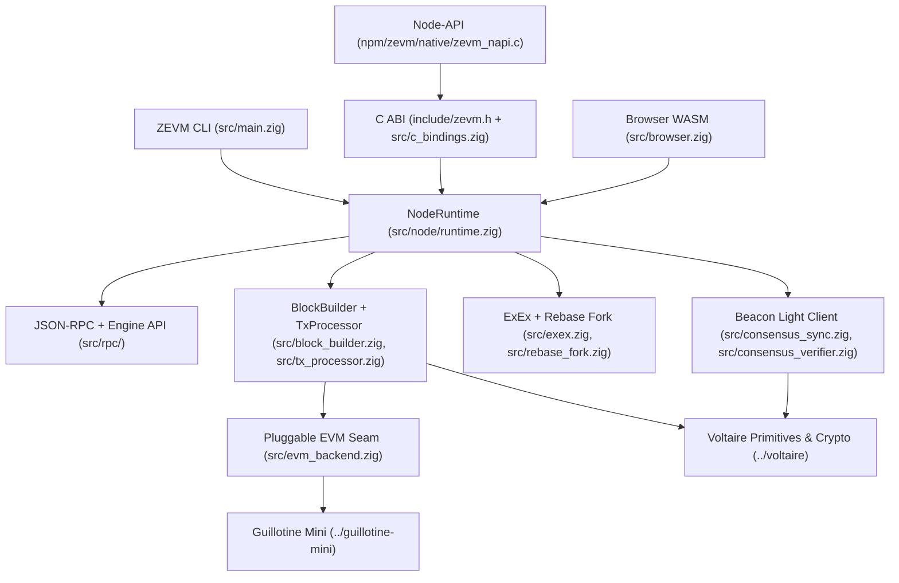

# Architecture & Dependency Boundaries

Back to [[Overview]].

ZEVM keeps a strict separation between Ethereum primitives, EVM bytecode execution, and node orchestration so upstream bugs are always fixed at their source rather than worked around locally.

## Pinned Native Siblings

- `build.zig.zon` resolves `../voltaire` and `../guillotine-mini` by local path.
- `native-dependencies.json` pins both repositories to immutable 40-hex commit SHAs.
- `tools/checkout-native.sh` clones missing siblings at their exact pins and refuses to overwrite a dirty or mismatched sibling checkout.
- `tools/native_deps_digest.mjs` hashes all native dependency sources into `.native-deps.digest` so every Zig target in `PACKAGE.ts` invalidates cleanly whenever a sibling changes.

## Pluggable EVM Backend Seam

`src/evm_backend.zig` abstracts EVM execution behind a typed backend interface (defaulting to `guillotine_mini` with support for external runners). This seam enables differential verification against reference interpreters and keeps `src/tx_processor.zig` decoupled from interpreter internals. See [[Execution-Engine]] and [[Formal-Verification-and-Fuzzing]].

## Zig 0.15.2 Ownership Rules

- Explicit `std.mem.Allocator` parameters on every allocating function (`CLAUDE.md`).
- Owning structs release all resources in `deinit` and guard partial initialization with `errdefer`.
- Zero leaks enforced under `std.testing.allocator` across unit and fuzz suites.
- No private top-level imported-symbol aliases (enforced by Uphill `style/no-private-import-aliases`).
