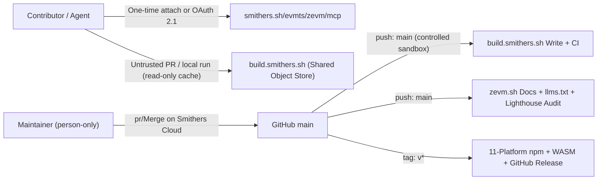

# Smithers Cloud Coding Factory

# Smithers Cloud Coding Factory

ZEVM is developed publicly through its Smithers Cloud Coding Factory at [smithers.sh/evmts/zevm](https://smithers.sh/evmts/zevm), continuously mirrored to GitHub (`evmts/zevm`).



## Personalized 3-Audience Factory UI

`.smithers/FACTORY.ts` projects `.smithers/home.json` (`docs: "https://zevm.sh/docs/llms.txt"`, `contributors: "role"`) with tailored sections for three audiences:

- **Maintainers (`Today`):** one-key `New branch` (`b`), live issue/PR triage queue, committed TODO stack, recent flow runs, and maintainer flows.
- **Contributors (`Contribute`):** local setup, incremental `smthrs ci`, Lighthouse backpressure commands, untrusted execution guidelines, one-time sandbox auth, and workspace links.
- **Viewers (`everyone`):** instant pre-clone product hero, Node-API quickstart, verified stats, subsystem cards, releases, and interactive flows.

## Shared Object Store & Untrusted Execution Policy

ZEVM uses `https://build.smithers.sh` as its shared Smithers Cloud object store (declared in `.smithers/WORKSPACE.ts`) with strict credential and namespace separation:

- **Non-maintainers are encouraged to run tests, fuzzers, and Uphill audits locally and on pull requests.**
- Pull requests and external contributor runs use `SMITHERS_TRUST=untrusted`, `SMITHERS_CACHE_NAMESPACE=pr-<number>`, and read-only cache credentials (`build.smithers.sh` refuses `PUT`/`DELETE` with `403`).
- Untrusted runs produce advisory audit reports badged `Untrusted External Run` and can never poison trunk cache or bypass required controlled-sandbox gates.
- Trunk cache writes (`SMITHERS_CACHE_WRITE_TOKEN`) run exclusively on controlled `main` builds.
- Approvals and merges are locked to authenticated humans (`policy.approvals: { approve: "person", merge: "person" }`, `.smithers/merge.json`).

## Lighthouse-Style Backpressure Audit

ZEVM scores 7 categories continuously through Uphill (`.agents/uphill/uphill.yaml`) and renders an interactive Lighthouse-style audit report (`tools/audit_report.mjs`):

- **Safety & TigerStyle**, **Style & Limits**, **Footprint & Modularity**, **Verification & Fuzzing**, **Documentation**, **Ethereum Conformance**, and **Smithers Factory & Trust**.
- Run locally: `node tools/audit_report.mjs --run --publish-docs docs/public/audit/index.html`.
- Live public report: [zevm.sh/docs/audit/](https://zevm.sh/docs/audit/).

## Authenticated MCP & One-Time Sandbox Auth

Agents interact with ZEVM over Streamable HTTP MCP at `https://smithers.sh/evmts/zevm/mcp`. Never embed long-lived tokens in prompts or container images. Print a single-use handoff with:

```sh
scripts/sandbox-auth --mode attach
scripts/sandbox-auth --mode mcp-config
scripts/sandbox-auth --mode untrusted --pr 42
```

## Obsidian Wiki & Mythical History

The repository maintains an Obsidian-compatible engineering wiki under `.smithers/wiki/` and a structured architectural chronicle in `.smithers/wiki/Mythical-History.md` and `.smithers/history/epics.json`. Validate all `[[wikilinks]]` and source citations with `node tools/wiki_sync.mjs --check`.

## Automatic Publishing on Merge

- **Docs, `llms.txt`, and Lighthouse Audit:** every merge to `main` runs `.github/workflows/docs.yml`, verifying `docs_mirror`, `llms.txt`, and wiki integrity, regenerating the Lighthouse audit page, building Astro Starlight, and deploying to `https://zevm.sh` (plus syncing Smithers Cloud feeds when configured).
- **npm & GitHub Releases:** tagging `v*` on a green `main` commit runs `.github/workflows/release.yml`, building all 11 native N-API platforms + browser WASM, publishing to npm with provenance, and creating the canonical GitHub Release with `release-tuple.json` and `light-default-checkpoints.json`.
